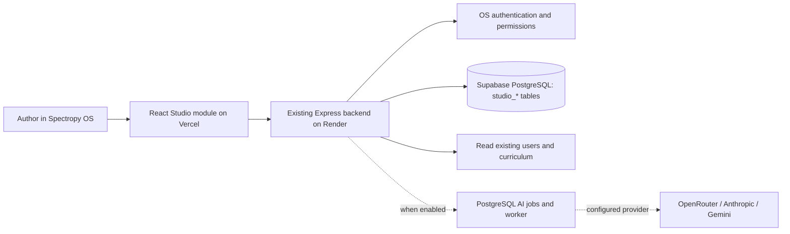

# Architecture and source map

Baseline: Version 1 · Phase 1, 19 September 2026. [Handbook](README.md)

## Runtime structure

There is one OS frontend deployment and one OS backend deployment. Studio is a feature inside those deployments. The local preview is a separate development tool, never a replacement for production authentication.

## Source ownership

| Path | Responsibility |
|---|---|
| Sibling `Digital_Teaching_Classroom/application/frontend/` | Canonical editor, presentation, types and styles |
| Sibling `Digital_Teaching_Classroom/application/server/` | Canonical API, schema, curriculum and AI logic |
| Sibling `Digital_Teaching_Classroom/application/migrations/` | Canonical additive SQL |
| Sibling `Digital_Teaching_Classroom/application/scripts/sync-os.mjs` | Copies owned source into this deployable LMS repository |
| [frontend module](../../frontend/src/features/digital-studio/module/) | Generated production frontend copy; edit canonical source first |
| [backend module](../../backend/studio/) | Generated backend copy |
| [migration](../../backend/scripts/studio/001_studio.sql) | Deployable SQL copy |
| [frontend adapter](../../frontend/src/pages/dashboard/content_authorizer/DigitalStudio.tsx) | OS API client, PDF extraction and shell wrapper |
| [routes](../../frontend/src/app/routes/AppRoutes.tsx) | Lazy-loaded permission-protected Studio route |
| [OS shell](../../frontend/src/pages/dashboard/content_authorizer/ContentAuthorizerShell.tsx) | Final sidebar item, conditional on permission |
| [backend adapter](../../backend/routes/studio.routes.js) | Reuses OS middleware, pool and optional worker |
| [backend entry](../../backend/server.js) | API registration and worker shutdown |
| [manifest](../../studio-module-manifest.json) | SHA-256 inventory of packaged module files |
| `docs/digital-studio/` | Canonical living handbook, versioned with LMS code |

The LMS builds without the sibling folder because packaged copies are committed. Conversely, canonical Studio tooling/tests and older discovery files are not automatically versioned by an LMS commit. Preserving the whole workspace in approved source control is an outstanding repository-governance decision; do not claim the sync script backs everything up.

## Save and presentation behavior

The editor maintains a structured workspace, with sessions and slides nested in JSON. Autosave waits approximately 1.5 seconds after edits. The server validates the document and supplied revision, locks the project for mutation, writes a new revision and records relevant audit events. Stale saves fail with a conflict instead of silently overwriting another edit.

Draft presentation reads the current lesson. Publication stores an immutable document snapshot in a separate release row. “Publish lesson” is not “deploy application,” does not post publicly, and does not assign the lesson to students. Access remains owner/scoped in this release. Media references still depend on retained assets.

## AI boundary

The UI requests named operations, never embeds vendor credentials. The backend checks an allowed model and stores a durable job containing the source revision and provider/model selection. A worker claims jobs atomically with `SKIP LOCKED`; it calls the provider outside a long-held database transaction. Validated proposals are reviewed and applied only if their base revision still matches.

The current worker runs in the existing backend process only when explicitly enabled. Provider switching is server configuration; authors choose allowed models. No silent cross-provider fallback or automatic paid retry is promised. The adapters exist, but production activation and real-model evaluation are pending.

## Security and operational boundaries

- OS authentication, Content Authorizer role and `studio.access` precede Studio resource queries.
- Resource operations enforce both owner ID and scope. Database RLS alone is insufficient because the configured backend database role can bypass it.
- Browser Supabase roles have no direct Studio table access. No service key belongs in frontend code.
- Uploads are bounded and authenticated. Current BYTEA storage shares database resources; malware scanning/private object storage are pending.
- AI outputs are declarative, validated lesson data, not executable JavaScript.
- Foreign keys reference existing users without altering their columns. They can briefly lock referenced objects and constrain future user deletion; separate tables do not eliminate all coupling.
- Lazy loading keeps editor/PDF code out of the initial OS bundle. Shared deployment, database and runtime failures can still affect the OS.

## Manual script parser — local extension

Canonical `frontend/script.ts` performs bounded deterministic interpretation. It does not execute source code, fetch source URLs or call AI. The original session script remains authoritative source material. Recognized fields populate existing native slide/interaction fields; unknown requirements become warnings. The storyboard stores candidate slides in UI state until author application. Append and confirmed replace route through normal edit history/autosave. A versioned component registry and stable source-to-block mapping are still pending.

## Reusable activity update — local, 21 September 2026

See [reusable activities](REUSABLE_ACTIVITIES.md) for the new versioned activity contract, editable comparison tables, step explanations and matching pairs, cross-subject examples, release compatibility and limitations. New comparison-row scripts now create aligned tables; legacy cards remain supported. This supersedes earlier planned-only/card-only descriptions for these three components. The full interaction library, source-aware merge and cinematic 3D remain pending. No production deployment, AI activation or LMS-table migration occurred.

## Local exploration/scene increment — 21 September 2026

[Hotspots, sorting and first 2D/3D scene](SCENES_AND_EXPLORATION.md) records the current controls, versioned contracts, ownership checks, examples, test evidence, deployment order and limitations. These features are now locally implemented; prior planned-only statements for this subset are superseded. P3/P4 remain partial. The full cinematic timeline, high-end graphics quality target and wider simulation library remain pending. Production remains unchanged; AI stays off.

## Editor composition boundary — F1a

`application/frontend/composition.ts` is a pure, editor-only adapter and command layer. Its `version: 1` describes the internal composition, not a new workspace API schema. Existing persisted Workspace schemaVersion 1 is unchanged. The source slide is cloned, so adaptation does not mutate drafts or releases. Blocks use deterministic slide/role identities; transformations use percentage coordinates. Restoring legacy data rejects unsupported layouts rather than dropping them. The module is not yet bound to Studio UI/autosave; server validation and asset ownership must accompany a future persisted multi-block contract. No engine dependency was added.

## Connected composition update

The earlier editor-only F1a description is superseded by [COMPOSITION_EDITOR.md](COMPOSITION_EDITOR.md). Studio now saves composition blocks through the validated API and uses CompositionView for both editing and presentation. Original fields remain conversion context, not a synchronized fallback. No engine dependency was added.

## F2 arrangement layer

`blockCommands.ts` implements immutable group-aware movement, alignment, grouping and layer operations. ArrangePanel provides checkbox selection and keyboard-operable commands; CompositionView previews group drags and renders styles. Backend validates group cardinality and tagged text styling. [Arrangement editor](ARRANGEMENT_EDITOR.md) records compatibility and remaining scope.
