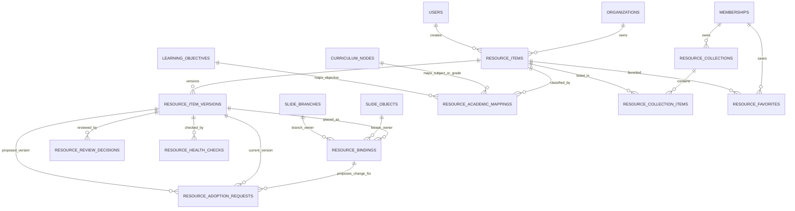

# Resource Library Entity Relationships

This diagram shows the Resource Library boundary designed from the Developer Guide. Existing Teaching Studio entities are shown only where the new tables reference them.

## Important semantics

- `resource_items.id` is the permanent identity. Renaming an item does not change it.
- `resource_item_versions` are numbered under one item. Approved or withdrawn version payloads are immutable.
- A binding points to one exact approved version and exactly one owner: a lesson `slide_object` or a clarification `slide_branch`.
- Prompt, launch and fallback JSON belong to the binding. Reusing a version does not share placement instructions.
- Collections and favorites reference the stable item identity. They neither copy content nor grant access to it.
- Academic mappings are many-to-one with an item, allowing cross-subject and cross-grade discovery without duplicating the resource.
